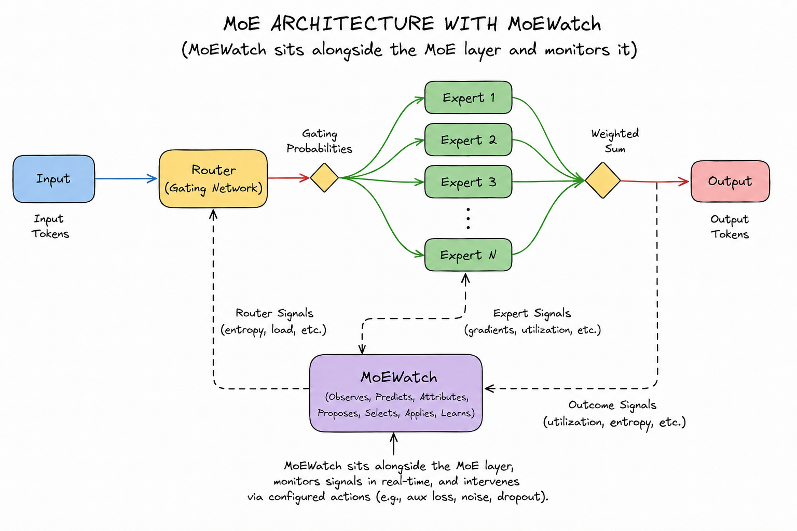

# MoEWatch

**Experimental diagnostics and benchmarking for Mixture-of-Experts (MoE) models.**

MoEWatch is an open-source research framework for studying routing behaviour, diagnosing routing collapse, and evaluating potential interventions during MoE training.



> **Status:** v0.2.0 is under development. APIs and features may change.

## Focus

- **Routing diagnostics** — investigate expert-load imbalance and routing entropy.
- **Collapse analysis** — study routing failures and their possible causes.
- **Intervention research** — evaluate approaches to mitigating routing collapse.
- **Benchmarking** — test diagnostic methods and interventions in controlled experiments.
- **Training integration** — explore integration with Hugging Face Transformers.

## Installation

```bash
pip install moewatch
```

## Quick start

See the [examples](examples/) and [documentation](docs/) for usage and current implementation details.

## Development

```bash
git clone https://github.com/Abineshabee/MoEWatch.git
cd MoEWatch
```

Install development dependencies and run the tests using the instructions in the repository.

## Project status

MoEWatch is an experimental research project. Results depend on the model, training setup, and evaluation methodology. It is not intended to guarantee detection or correction of every routing failure.

## License

MIT — see [LICENSE](LICENSE).
